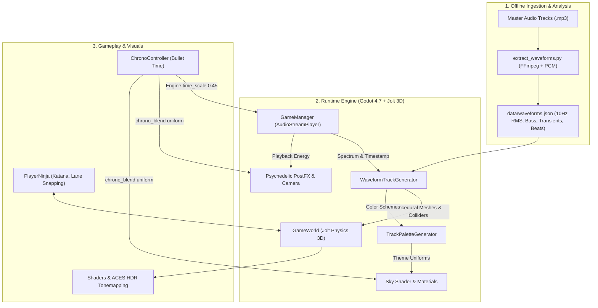
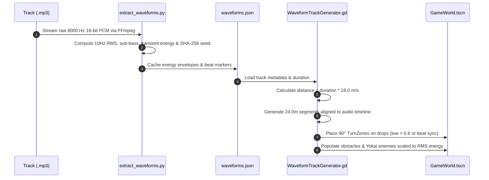
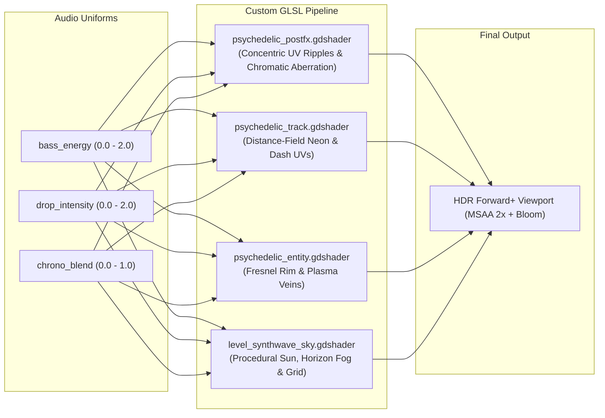

# ⚡ Ninja Run

[](https://godotengine.org)
[](https://docs.godotengine.org/en/stable/tutorials/rendering/renderers_and_rendering_devices.html)
[](https://github.com/godot-jolt/godot-jolt)
[](tools/test_game.gd)
[](LICENSE)
[-blue?style=for-the-badge&logo=github)](https://github.com/leouofa)

> **High-octane, audio-reactive 3D endless/rhythm runner built with Godot 4.7.**  
> Procedural level generation driven by 10 Hz MP3 waveform analysis, custom GLSL spatial & post-processing shaders, Jolt 3D physics, bullet-time Chrono-Focus mechanics, and a headless automated test suite.

---

## 📑 Table of Contents
- [Architecture & Systems Overview](#-architecture--systems-overview)
- [Audio-Driven Procedural Level Generation](#-audio-driven-procedural-level-generation)
- [Custom Shaders & Visual Effects Pipeline](#-custom-shaders--visual-effects-pipeline)
  - [Post-Processing Canvas Item (Audio Ripples & Chromatic Aberration)](#1-screen-space-post-processing-shader-shaderspsychedelic_postfxgdshader)
  - [Audio-Reactive Roadway Shader](#2-audio-reactive-roadway-shader-shaderspsychedelic_trackgdshader)
  - [Dynamic Entity Shader & Strict Visual Hierarchy](#3-dynamic-entity-shader-shaderspsychedelic_entitygdshader)
  - [Procedural Synthwave Sky Dome](#4-procedural-synthwave-sky-dome-shaderslevel_synthwave_skygdshader)
- [Physics & Gameplay Mechanics](#-physics--gameplay-mechanics)
- [Project Layout](#-project-layout)
- [Developer Quickstart & Tooling](#-developer-quickstart--tooling)
- [Licensing & Credits](#-licensing--credits)

---

## 🏛 Architecture & Systems Overview

Ninja Run is engineered around decoupled, event-driven subsystems designed for high framerate determinism (targeting 60–144 Hz) and real-time audio reactivity.



### Core Technologies
- **Engine**: Godot Engine 4.7 (Forward+ Vulkan / Direct3D 12 backend with ACES HDR bloom and glow).
- **Physics**: Jolt Physics 3D integration with continuous collision detection and custom kinematic lane interpolators.
- **Data Ingestion**: Python 3.10+ / FFmpeg audio energy extractor calculating root-mean-square (RMS) and sub-bass transients at 100 ms intervals.
- **Modeling & VFX**: Procedural asset pipeline generating stylized GLB assets via headless Blender Python scripting.

---

## 🎵 Audio-Driven Procedural Level Generation

Rather than hand-crafting levels or relying on pseudo-random noise alone, levels in Ninja Run are **synthesized directly from musical waveforms**.



### 1. Offline Signal Processing (`tools/extract_waveforms.py`)
Audio tracks are decoded into mono 8000 Hz 16-bit signed PCM streams via FFmpeg and bucketed into 100 ms (10 Hz) slices:
- **RMS Energy ($E_{\text{rms}}$)**: Measures overall track loudness to govern enemy population density and track elevation.
- **Sub-Bass Energy ($E_{\text{bass}}$)**: High-pass and low-pass windowed sample deltas identifying heavy kick drums and 808 basslines.
- **Transient Energy ($E_{\text{high}}$)**: Captures snare hits and hi-hats for rhythmic hazard activation.
- **Deterministic Seeding**: Generates a 64-bit integer hash from track audio data ensuring identical procedural track layouts for any given song.

### 2. Runtime Roadway & Junction Construction (`scripts/WaveformTrackGenerator.gd`)
- **Metric Mapping**: With a baseline runner speed $v = 18.0\text{ m/s}$ and segment length $L = 24.0\text{ m}$, each segment represents exactly $1.333\text{ seconds}$ of music.
- **Dynamic Branching & 90° Turns**: When a beat drops or low-frequency energy exceeds threshold ($E_{\text{bass}} > 0.6$), the generator spawns a `TurnZone`. High RMS moments ($E_{\text{rms}} > 0.7$) trigger T-junctions offering split branching paths.
- **Lane Width & Safe Corridors**: Standardized $3.6\text{ m}$ lane widths ($12.4\text{ m}$ total road width) with guaranteed $1.8\text{ m}$ clear air margins around obstacles (`obstacle_barricade.glb`, `obstacle_high_gate.glb`), verified across all framerates.

---

## 🎨 Custom Shaders & Visual Effects Pipeline

Ninja Run features custom GLSL shaders written for Godot's shading language, tightly coupled to the audio engine and time-dilation controllers.



---

### 1. Screen-Space Post-Processing Shader (`shaders/psychedelic_postfx.gdshader`)

Applied as a fullscreen `CanvasItem` screen-reading shader over the 3D viewport.

#### Concentric Bass Ripple Waves
Expanding acoustic shockwaves distort screen UVs radiating outward from screen center during bass drops:

$$\Delta \mathbf{uv} = \frac{\mathbf{uv} - \mathbf{c}}{\|\mathbf{uv} - \mathbf{c}\|} \cdot \sin\Big(28 \|\mathbf{uv} - \mathbf{c}\| - t(6 + 4 E_{\text{bass}})\Big) \cdot \Big(0.003 E_{\text{bass}} + 0.005 I_{\text{drop}}\Big)$$

```glsl
// Audio-reactive UV Bass Ripple
float ripple_phase = dist_from_center * 28.0 - TIME * (6.0 + bass_energy * 4.0);
float ripple_amount = sin(ripple_phase) * (bass_energy * 0.003 + drop_intensity * ripple_intensity);
vec2 ripple_uv = uv;
if (dist_from_center > 0.001) {
    ripple_uv += (center_delta / dist_from_center) * ripple_amount;
}
```

#### Radial Chromatic Aberration
Separates R and B channels along radial vectors $\mathbf{d} = \frac{\mathbf{uv} - \mathbf{c}}{\|\mathbf{uv} - \mathbf{c}\|}$, scaling non-linearly with edge distance and player combo:

$$\text{CA} = \Big(\text{base} + 0.005 E_{\text{bass}} + 0.009 I_{\text{drop}} + 0.005 R_{\text{combo}} + 0.007 B_{\text{chrono}}\Big) \cdot \big(1.45 \|\mathbf{uv} - \mathbf{c}\|\big)^{1.7}$$

```glsl
float col_r = texture(screen_texture, ripple_uv + ca_dir * total_ca).r;
float col_g = texture(screen_texture, ripple_uv).g;
float col_b = texture(screen_texture, ripple_uv - ca_dir * total_ca).b;
```

#### Chrono-Focus Time-Warp Screen Tone
When the player engages time-dilation, $B_{\text{chrono}}$ smoothly interpolates the viewport into an icy cyan desaturated palette with a dark peripheral vignette:
```glsl
if (chrono_blend > 0.01) {
    float luma = dot(col, vec3(0.299, 0.587, 0.114));
    vec3 chrono_tint = mix(vec3(luma), col, 0.65) * vec3(0.65, 1.05, 1.25);
    col = mix(col, chrono_tint, chrono_blend * 0.7);
    float chrono_vignette = smoothstep(0.3, 0.85, dist_from_center) * chrono_blend * 0.35;
    col = mix(col, vec3(0.02, 0.15, 0.28), chrono_vignette);
}
```

---

### 2. Audio-Reactive Roadway Shader (`shaders/psychedelic_track.gdshader`)

Renders the multi-lane roadway using distance fields in local model coordinates:
- **Lane Dividers**: Analytical distance to $x = \pm \frac{\text{lane\_width}}{2}$ ($x = \pm 1.8\text{ m}$) creates crisp, anti-aliased dashed neon markings without texture seams.
- **Audio Scrolling**: Dash frequency accelerates with bass energy:
  ```glsl
  float dash_z = lz + t * scroll_speed * (0.8 + bass_energy * 0.4);
  float dash_mod = mod(dash_z, 5.0);
  float dash_mask = smoothstep(0.2, 0.4, dash_mod) * smoothstep(4.8, 4.6, dash_mod);
  ```
- **Transversal Synthwave Grid**: High-frequency grid pulses rendered across the track deck reacting to low-frequency beats.

---

### 3. Dynamic Entity Shader (`shaders/psychedelic_entity.gdshader`)

Entities (Yokai enemies, obstacles, and pickups) utilize a unified spatial shader featuring three distinct operating modes:
1. `pattern_mode = 0`: **Iridescent Shimmer** (Koban coins, Chrono hourglass pickups)
2. `pattern_mode = 1`: **Scrolling Plasma Veins** (Yōkai enemies: Oni, Tengu, Samurai, Witch, Skeleton, Spirit, Lantern)
3. `pattern_mode = 2`: **Hazard Chevrons / Runes** (Barricades & High Gates)

#### Strict Threat vs. Reward Color Hierarchy
To maintain split-second gameplay clarity at high speed:
- **Threats (Enemies & Hazards)**: Strictly rendered in crimson red, vermilion orange, and dark obsidian cores. Slashed by katana or dodged.
- **Rewards (Koban & Time Pickups)**: Strictly rendered in luminous gold (`#FFD700`) and cyan electric glow (`#00FFFF`).
- **Fresnel Rim**: High-power rim lighting makes silhouettes immediately identifiable against dark synthwave horizons:
  $$\text{Rim} = (1.0 - \mathbf{N} \cdot \mathbf{V})^{\text{power}}$$

---

### 4. Procedural Synthwave Sky Dome (`shaders/level_synthwave_sky.gdshader`)

- **Procedural Low-Poly Sun**: Ray-traced sphere with animated horizontal scanline cutouts modulating with song duration.
- **Horizon Color Blending**: Exponentiated gradient transitioning from deep space zenith down to warm neon horizon haze.
- **Dynamic Themes**: Driven by `TrackPaletteGenerator.gd`, shifting between 4 audio-reactive themes: *Cyber*, *Inferno*, *Frost*, and *Dusk*.

---

## ⚙️ Physics & Gameplay Mechanics

### 1. Framerate-Independent Kinematic Movement (`scripts/PlayerNinja.gd`)
- Continuous forward momentum ($v = 18.0\text{ m/s}$) combined with exponential dampening for horizontal lane switches:
  $$x(t) = \text{lerp}(x, x_{\text{target}}, 1.0 - e^{-\lambda \Delta t})$$
- Verified for zero lane drift across 30, 60, 120, and 144 FPS in automated test suites.

### 2. Chrono-Focus Time Dilation (`scripts/ChronoController.gd`)
- Slows global physics engine time scale to `0.45` while preserving player response agility:
  ```gdscript
  Engine.time_scale = 0.45
  AudioServer.playback_speed_scale = 0.45
  ```
- Dynamic shader uniforms smoothly lerp from `0.0` to `1.0` during activation to blend visual and auditory time warp effects.

### 3. QTE Bezier Auto-Steering (`scripts/TurnZone.gd`)
- Detects entry into 90° corner zones; player executes a timed turn input (left/right arrow, `A`/`D`, or gamepad).
- Smoothly steers the runner onto the orthogonal track axis via quadratic Bezier interpolation without camera disorientations.

---

## 📁 Project Layout

```
ninja-run/
├── assets/                     # 3D assets, themes, and UI resources
│   ├── models/                 # 14 procedurally generated GLB models
│   │   ├── enemy_*.glb         # Oni, Tengu, Samurai, Witch, Skeleton, Spirit, Lantern
│   │   ├── obstacle_*.glb      # Barricades, High Gates
│   │   └── pickup_*.glb        # Koban coins, Chrono Hourglass
│   └── synthwave_theme.tres    # Godot UI control theme
├── data/
│   └── waveforms.json          # Precomputed 10Hz energy envelopes & seeds
├── scenes/
│   ├── GameWorld.tscn          # Main 3D runtime environment
│   └── MainMenu.tscn           # Track selector, settings, and high score UI
├── scripts/
│   ├── ChronoController.gd     # Bullet-time time-scale manager
│   ├── EnemyBase.gd            # Yōkai behavior, hitbox, and katana slash logic
│   ├── GameManager.gd          # Autoload singleton: state, audio, scores
│   ├── GameWorld.gd            # World orchestration & camera controller
│   ├── PlayerNinja.gd          # Runner controller, physics, lane shifting
│   ├── TrackPaletteGenerator.gd# Color palette generation per soundtrack theme
│   ├── TurnZone.gd             # 90° QTE turning triggers & Bezier steering
│   └── WaveformTrackGenerator.gd # Procedural track synthesis from audio data
├── shaders/
│   ├── level_synthwave_sky.gdshader # Procedural sun, horizon, & starfield
│   ├── psychedelic_entity.gdshader  # Fresnel, plasma veins & threat shaders
│   ├── psychedelic_postfx.gdshader   # Fullscreen UV ripple & chromatic aberration
│   ├── psychedelic_track.gdshader   # Distance-field neon lane dividers
│   └── synthwave_background.gdshader# Main menu background effect
├── tools/
│   ├── extract_waveforms.py    # Offline audio analyzer (FFmpeg + PCM)
│   ├── generate_blender_assets.py # Procedural 3D modeler (Blender API)
│   └── test_game.gd            # Headless automated engine test runner (20 tests)
├── tracks/                     # 36 original music tracks (.mp3)
├── project.godot               # Engine configuration & Forward+ settings
└── LICENSE                     # Dual license terms
```

---

## 🚀 Developer Quickstart & Tooling

### Prerequisites
- [Godot Engine 4.7+](https://godotengine.org/download) with Forward+ / Vulkan support.
- [Python 3.10+](https://www.python.org/) with `ffmpeg` installed (for audio waveform extraction).
- [Blender 3.6+](https://www.blender.org/) (optional, only needed for regenerating 3D models).

---

### Running the Headless Engine Test Suite
Ninja Run includes an automated test runner validating game systems without launching a display server:

```bash
godot --headless -s tools/test_game.gd
```

**Verification Checklist executed by `test_game.gd`:**
```
=== RUNNING AUTOMATED GAME ENGINE TESTS ===
[PASS] All 36 soundtrack levels loaded successfully.
[PASS] Slash action successfully bound to both Space and F.
[PASS] Chrono-Focus slowdown works: Engine.time_scale == 0.45, charges decremented.
[PASS] Chrono-Focus returned time scale to 1.0.
[PASS] Every single Yōkai enemy type is killed with a Katana Slash!
[PASS] Procedural track generated 100 segments and 8 turn zones.
[PASS] Widened track constants verified: TRACK_WIDTH=12.4m, LANE_WIDTH=3.6m.
[PASS] Obstacle width and safety clearances (> 1.7m clear air) verified.
[PASS] Framerate-independent lane switching verified @ 30, 60, 120, and 144 FPS.
[PASS] QTE Turn auto-steering Bezier curve verified.
[PASS] High score, kill tracking, and persistence verified.
[PASS] Koban & Chrono Slowdown pickup score values verified.
[PASS] Title Screen procedural synthwave shader & random shuffler verified.
[PASS] TrackPaletteGenerator & 360° reactive sky verified across metadata themes.
[PASS] Psychedelic Visual Pipeline verified (PostFX, Entity shaders, ACES bloom).
[PASS] Strict Threat vs. Reward Color Hierarchy verified.

=== TEST SUMMARY: 20 PASSED, 0 FAILED ===
ALL SYSTEMS OPERATIONAL!
```

---

### Offline Waveform Extraction
To extract audio envelopes from new soundtrack files placed in `tracks/`:

```bash
python3 tools/extract_waveforms.py
```
*Outputs updated `data/waveforms.json` with 10 Hz RMS, sub-bass, high transient arrays, and SHA-256 deterministic seeds.*

---

### Procedural 3D Asset Generation
All 14 in-game 3D models (`assets/models/*.glb`) are generated programmatically via Blender's Python API:

```bash
blender -b -P tools/generate_blender_assets.py
```

---

## 📜 Licensing & Credits

This project operates under a **Dual-License** structure:

### 1. Game Engine Code, Shaders, Scripts & Assets: MIT License
All software code, GDScript files, GLSL shaders, Python pipelines, scene structures, and procedural 3D model assets are licensed under the open-source **[MIT License](LICENSE)**.

```
Copyright (c) 2026 Leonid Medovyy (https://github.com/leouofa)
```

You are free to use, modify, distribute, and integrate the engine code, shaders, and procedural pipelines into personal or commercial projects under the terms of the MIT License.

### 2. Original Soundtrack & Music: Proprietary (All Rights Reserved)
All 36 original music compositions and `.mp3` audio recordings in the [`tracks/`](tracks/) directory are proprietary intellectual property:

```
Copyright (c) 2026 Leonid Medovyy. All Rights Reserved.
```

- **Permitted**: Local playback and personal, non-commercial gameplay while running, modifying, or testing the Ninja Run game client.
- **Prohibited**: Public broadcasting, streaming distribution, independent synchronization, commercial release, sampling, or re-licensing of the soundtrack without prior written consent from the author.

---

### Author & Attribution
Developed and designed by **Leonid Medovyy**  
GitHub: [@leouofa](https://github.com/leouofa)  
Email: [leonid@macron1.io](mailto:leonid@macron1.io)
